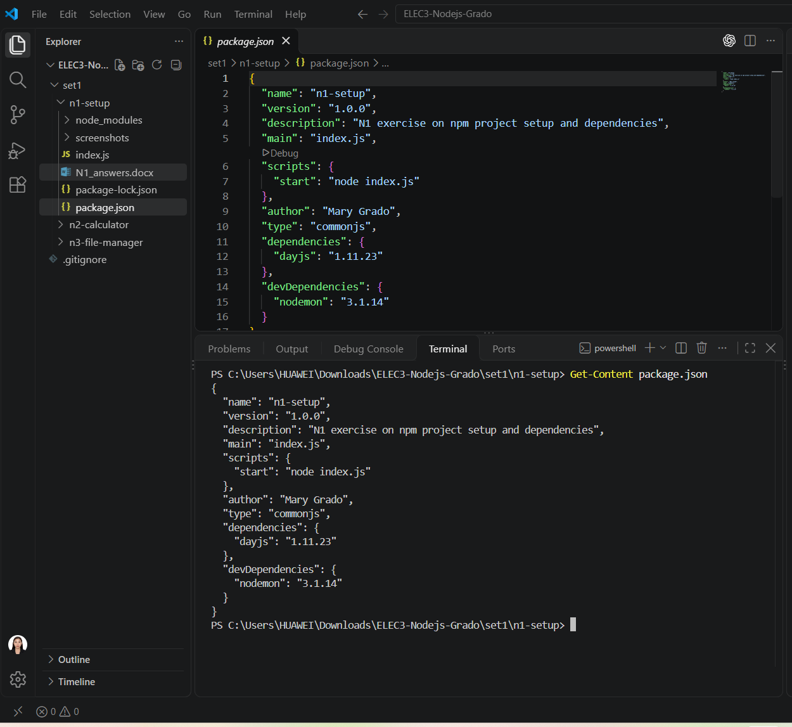
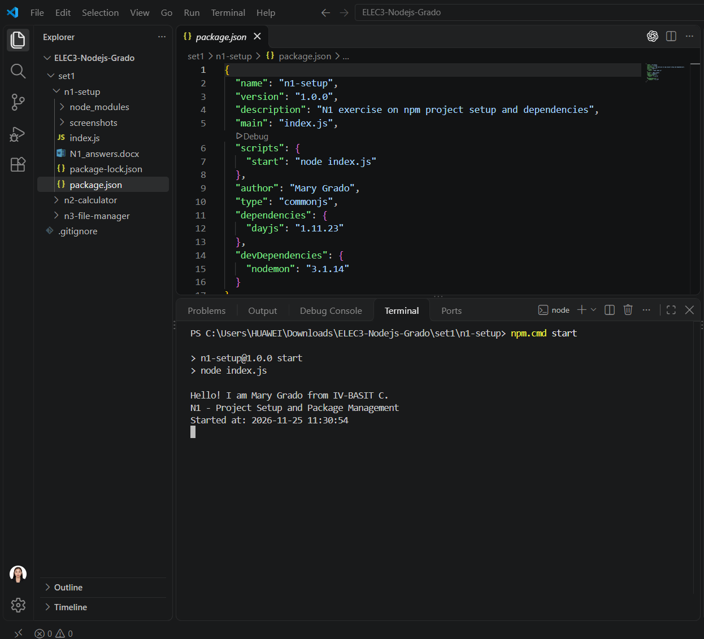

# ELEC 3 - Node.js

- **Name** Mary Grado
- **Section** IV-BASIT C

## Set 1

| Activity | Description |
| --- | --- |
| [N1 - Project Setup and Package Management](set1/n1-setup/) | Sets up an npm project with a start script, a runtime dependency, and a development dependency. |

### N1 - Project Setup and Package Management

From the repository root, run:

```powershell
cd set1/n1-setup
npm.cmd install
npm.cmd start
```

The project uses Day.js to print a timestamp. Nodemon is installed as a development dependency. See [N1_answers.docx](set1/n1-setup/N1_answers.docx) for the package field explanations.





