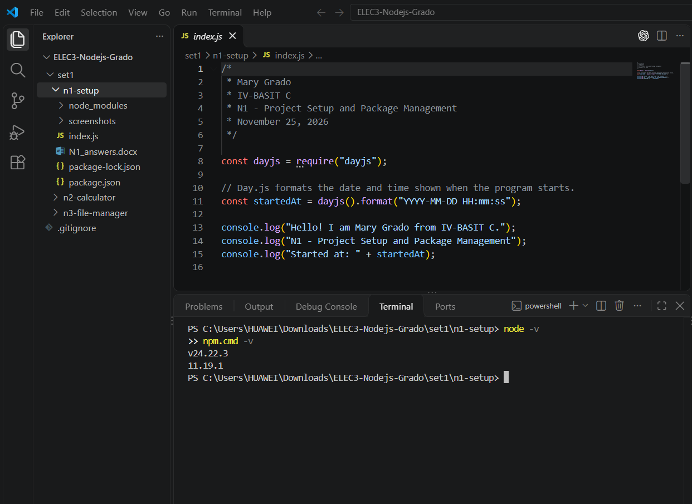
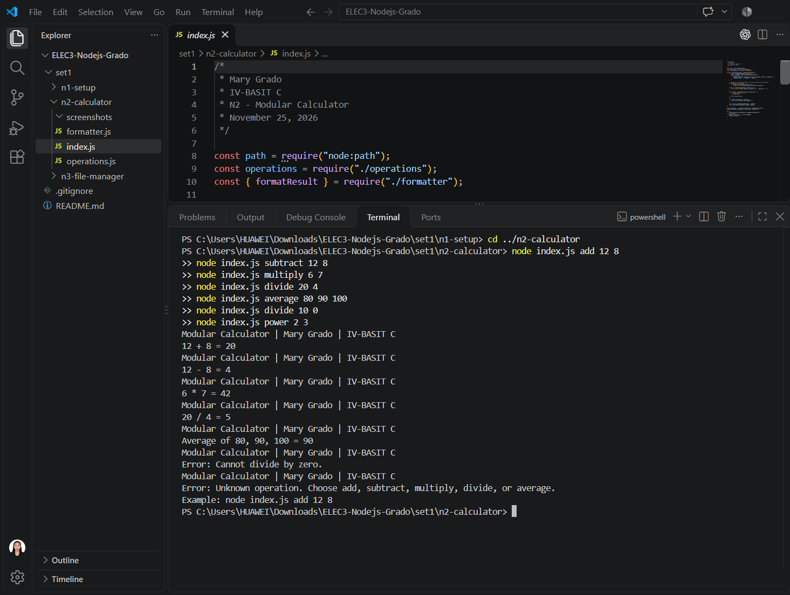
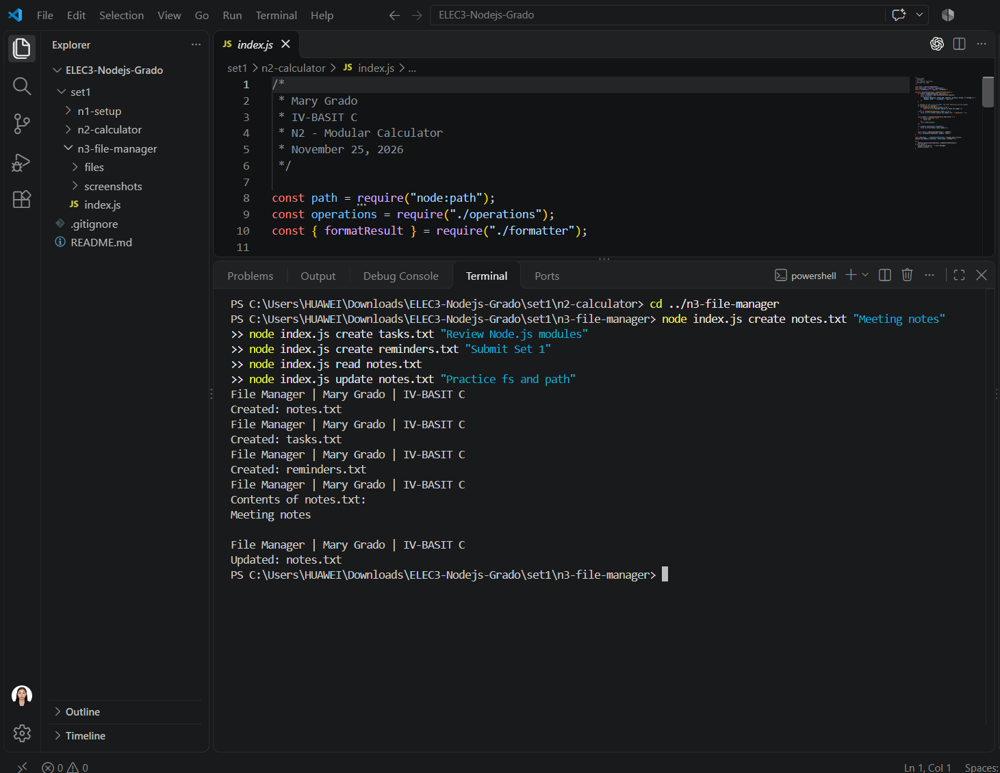
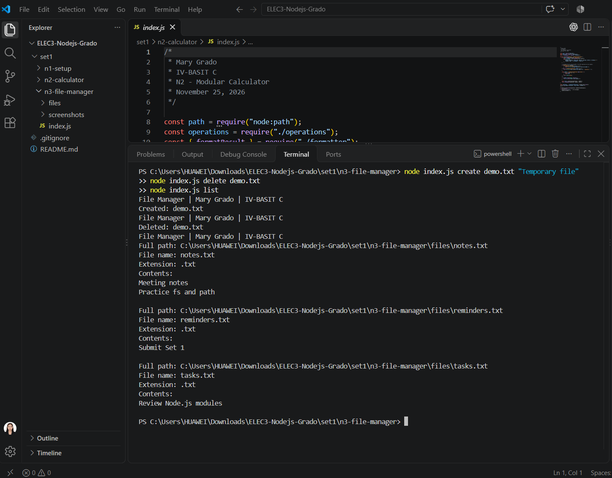

# ELEC 3 - Node.js

- **Name** Mary Grado
- **Section** IV-BASIT C

## Set 1

| Activity | Description |
| --- | --- |
| [N1 - Project Setup and Package Management](set1/n1-setup/) | Sets up an npm project with a start script, a runtime dependency, and a development dependency. |
| [N2 - Modular Calculator](set1/n2-calculator/) | Runs five operations from the command line using CommonJS modules. |
| [N3 - File Manager](set1/n3-file-manager/) | Creates, reads, appends to, deletes, and lists text files using fs and path. |

### N1 - Project Setup and Package Management

From the repository root, run:

```powershell
cd set1/n1-setup
npm.cmd install
npm.cmd start
```

The project uses Day.js to print a timestamp. Nodemon is installed as a development dependency. See [N1_answers.docx](set1/n1-setup/N1_answers.docx) for the package field explanations.




### N2 - Modular Calculator

From the repository root, run:

```powershell
cd set1/n2-calculator
node index.js add 12 8
node index.js subtract 12 8
node index.js multiply 6 7
node index.js divide 20 4
node index.js average 80 90 100
```

Try division by zero with `node index.js divide 10 0` and an unknown operation with `node index.js power 2 3`.



### N3 - File Manager

From the repository root, run:

```powershell
cd set1/n3-file-manager
node index.js list
node index.js create example.txt "Example text"
node index.js read example.txt
node index.js update example.txt "More text"
node index.js delete example.txt
```

The files folder contains the three text files produced in the sample run. The list command shows each full path, file name, extension, and contents.




